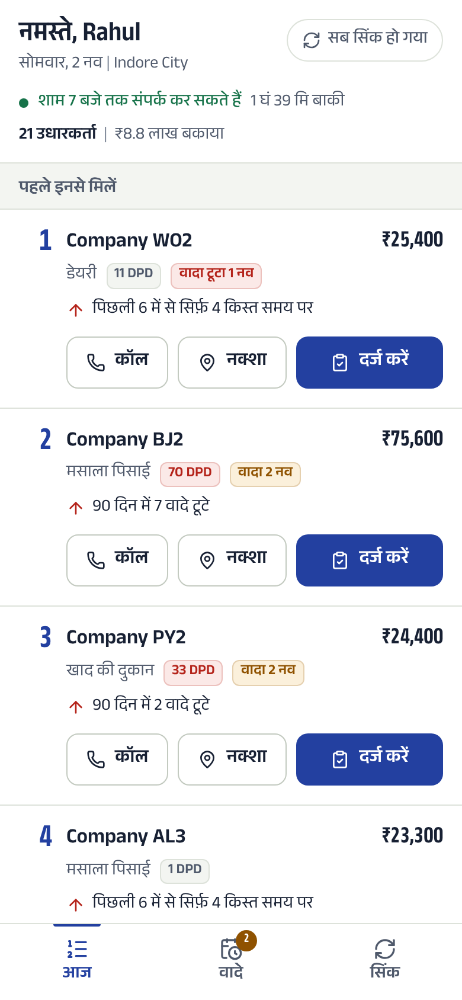
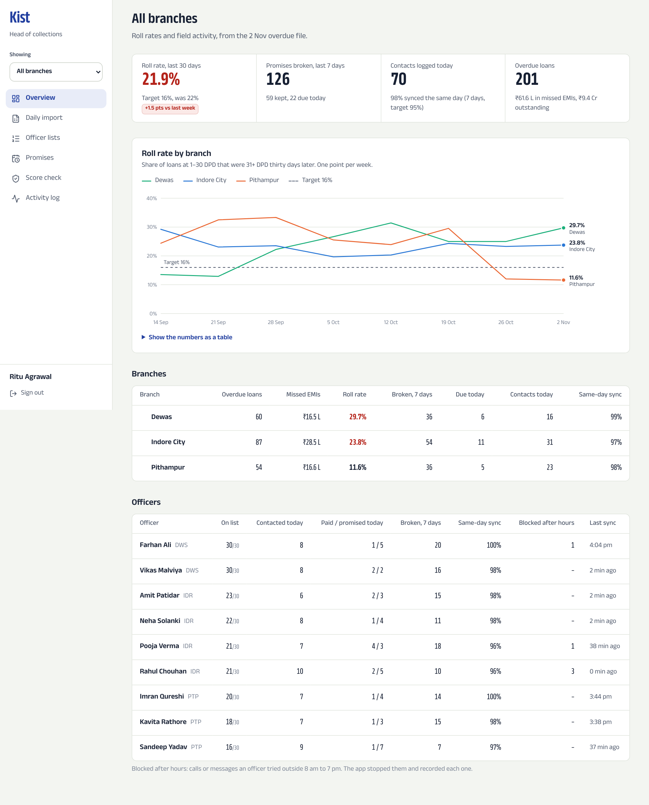

# Kist: field collections for an MSME lender

Kist (किस्त, "instalment") is a field-collections app for Company A, an Indore NBFC lending to small manufacturers and traders. Each morning the branch manager imports the overdue file. Every field officer then opens a short, ordered list of borrowers on their phone, with the reasons behind the order. Officers log what happened in three taps, even with no signal, and managers see roll rates by branch without waiting for Friday's Excel.

This is the CORE BUILD slice of the brief, end to end: overdue CSV import and assignment, officer priority list, outcome logging, promise tracker and manager roll-rate view. It also covers two of the brief's hard parts: offline logging with sync, and the 8 am to 7 pm contact block.

| Officer app (Hindi, phone) | Manager overview |
|---|---|
|  |  |

## What works

**Field officer (phone, Hindi or English)**
- Today's list, ordered by an AI priority score, with the top reason on each borrower and all three on the detail page
- Call and Map buttons; outcome logging in three taps (paid, promise, not reachable, dispute) with GPS
- Works offline: entries are saved on the phone (IndexedDB) and synced when the network returns; the app opens with no signal (service worker)
- Calls, visits and reminders are blocked outside 8 am to 7 pm IST, and every attempt is recorded. The server re-checks on corrected time, so a wrong phone clock does not get round it
- Promise reminders drafted from approved templates, with a filter that blocks threatening or shaming words; nothing is sent without the officer's tap (sending is simulated)

**Branch manager and head of collections (desktop or phone)**
- Daily CSV import with a dry-run preview: row-level errors, new and paid-up loans, and the assignment plan by pincode and workload
- Officer lists: reorder the AI's suggestion, reassign, clear the unassigned queue
- Roll rate by branch (1-30 DPD to 31+ over 30 days), broken promises, same-day sync rate, officer activity
- Promise tracker, weekly score back-test, activity log with visit locations, append-only audit trail
- Role-based access: officers see only their own loans, managers only their branch, the head sees all

## Tech

Next.js 16 (App Router) and TypeScript, Postgres with Drizzle ORM, Tailwind CSS 4, Vitest, IndexedDB on the phone, signed-cookie sessions (jose, bcrypt). The priority model is a logistic regression trained by `scripts/train-model.ts` and runs in the app; it needs no AI service or API key.

## Run it locally

You need Node 20 or newer and Postgres 14 or newer.

```bash
npm install
cp .env.example .env.local      # fill in DATABASE_URL, SESSION_SECRET, DEMO_PASSWORD
npm run db:migrate
npm run db:seed                 # 150 days of simulated history plus today's file
npm run dev                     # http://localhost:3000
```

Sign in with a demo account from the sign-in page (shown when `DEMO_MODE=true`), or use `rahul@kist.test` (officer), `sanjay@kist.test` (manager) or `ritu@kist.test` (head) with your `DEMO_PASSWORD`. Full steps, deployment and environment variables are in [deployment.md](deployment.md).

## Tests

```bash
npm test          # 57 tests: core rules, plus database tests when TEST_DATABASE_URL is set
npm run typecheck
npm run lint
```

The database tests run on a separate, disposable database (`TEST_DATABASE_URL`). They cover duplicate syncs, loans that belong to another officer, the 7 pm block, a slow phone clock, blocked words, promise settlement and the import guards.

## Project layout

```
src/lib/          Pure rules shared by phone and server: contact window, scoring, assignment,
                  CSV validation, roll rate, promises, reminder templates, sync protocol, i18n
src/server/       Database schema, auth, audit log, import and sync services, page queries
src/client/       Phone-side storage (IndexedDB), sync engine, GPS
src/components/   Officer app, manager screens, shared UI
src/app/          Pages and API routes
scripts/          Migrations, seed simulation, model training
tests/            Unit and database tests
docs/             Screenshots
```

## Limits

Payments, SMS and WhatsApp are simulated, as the brief allows. The score is trained on simulated history because the brief has no real loan data; retrain on Company A's own history before go-live. More in the Technical Design Document.
